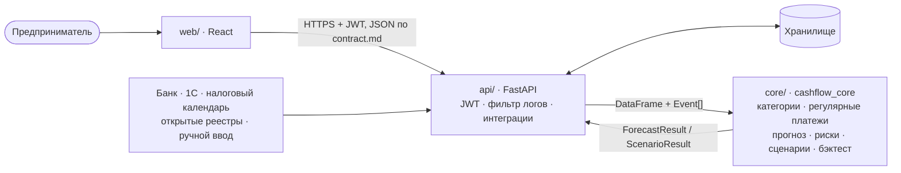

# Архитектура решения

Сервис прогнозирует остаток на расчётном счёте малого бизнеса по дням на 30+ дней вперёд, находит кассовые разрывы (дата, сумма, вероятность) и объясняет их простыми словами.

Схема: [`architecture.svg`](architecture.svg) · [`architecture.png`](architecture.png) · исходник [`architecture.mmd`](architecture.mmd).


> Описание опирается на контракт [`contract.md`](contract.md). Детали реализации `api/` и `core/` (хранилище, модель прогноза) сверять с README этих папок — пункты, которые зависят от них, помечены «⟶ уточнить».



## 1. Компоненты

| слой | папка | ответственность | технологии |
|---|---|---|---|
| Интерфейс | `web/` | понятный экран «хватит ли денег», графики, сценарии, ручной ввод | React, Vite, TypeScript, Recharts |
| API | `api/` | аутентификация, REST по контракту, хранение, интеграции, фильтр логов | FastAPI, JWT |
| Ядро | `core/` | загрузка и чистка выписки, категоризация, регулярные платежи, прогноз, риски, сценарии, бэктест | Python, pandas |
| Данные | `data/raw/` | выписки 150 компаний за 01.10.2024–30.09.2026 от организаторов | CSV |
| Демо-данные | `data/synthetic/` | сценарий с заложенным разрывом, если в реальных данных нет подходящей компании | CSV |

## 2. Потоки данных

1. **Загрузка выписки.** Пользователь перетаскивает CSV → `web` проверяет файл в браузере (формат, кодировка, колонки) → `POST /api/companies` → `api` сохраняет файл и вызывает `core.load_statement`.
   `load_statement` переводит колонки датасета во внутренние имена (`operation_date → date`, `payment_purpose → purpose`, `Поступление/Списание → in/out`), читает ИНН строкой, убирает дубли, помечает пропуски дней.
2. **Понимание истории.** `categorize` присваивает каждой операции категорию и уверенность (налоги/ЕНП в разных написаниях, зарплата, аренда, кредиты, закупки, выручка, переводы собственных средств, возвраты). `detect_recurring` находит регулярные платежи с периодом и датой следующего.
3. **Будущие события.** Ожидаемые платежи (`Event`) приходят из интеграций и ручного ввода и хранятся в `api`:

   | источник | что даёт | `Event.source` / `type` |
   |---|---|---|
   | Банк (выписка) | история операций, остаток, регулярные платежи, кредиты | `bank` / `loan`, `contract` |
   | 1С | выставленные и полученные счета, договоры, зарплатные ведомости | `1c` / `invoice`, `contract`, `payroll` |
   | Налоговый календарь | даты ЕНП (28-е число) и оценка суммы по истории | `tax_calendar` / `tax` |
   | Открытые реестры | госконтракты и этапы оплаты, данные о контрагентах | `open_registry` / `contract` |
   | Ручной ввод | «клиент обещал заплатить», «закупка оборудования» | `manual` / `manual` |

4. **Прогноз.** `forecast(df, events, horizon)` строит остаток по дням: ожидаемый (`balance_p50`) и возможный диапазон (`balance_low`–`balance_high`). Из дней, где остаток может уйти ниже нуля, формируются риски: дата, нехватка, вероятность, уровень, причина и рекомендации простым языком. Метод модели ⟶ уточнить в `core/README.md`.
5. **«Что если».** `POST /scenarios/run` → `run_scenarios` пересчитывает прогноз при задержке клиента, падении выручки, внеплановом расходе или росте постоянных затрат → `web` рисует базовый и негативный прогноз на одном графике.
6. **Новые операции.** `POST /transactions` → `update_forecast(state, new_rows)` обновляет прогноз без полного пересчёта; план-факт показывает, какие ожидаемые платежи не пришли.
7. **Проверка качества.** `backtest` / `compare_models` прогоняют модель «из прошлого» на реальных выписках и пишут `core/reports/metrics.json` → страница «Качество прогноза».

## 3. Безопасность

- **Аутентификация:** `POST /api/auth/login` → JWT; все остальные эндпоинты требуют `Authorization: Bearer`. Токен истекает, при 401 интерфейс возвращает на экран входа.
- **Изоляция данных:** доступ только к своим `company_id`.
- **Логи без чувствительных данных:** фильтр логов в `api` маскирует ИНН, наименования контрагентов, назначения платежей и суммы; в логах — только технические поля (метод, путь, код ответа, время). ⟶ уточнить в `api/README.md`.
- **Интерфейс:** выписка не сохраняется в браузере; в `localStorage` — только токен и id компании.
- **Данные:** все компании и ИНН в датасете вымышленные.

## 4. Развёртывание (демо)

```
web  (Vite dev :5173 или статические файлы)  ──/api──►  api (uvicorn :8000)  ──import──►  core (пакет)
```

Запуск каждой части — в README своей папки: [`web/README.md`](../web/README.md), `api/README.md`, `core/README.md`.

## 5. Развитие

- Реальные коннекторы: API банка Центр-Инвест (выписка в реальном времени), обмен с 1С, ФНС.
- Push/Telegram-уведомления о приближающемся разрыве.
- Подбор продукта банка под разрыв (овердрафт, кредитная линия) прямо из предупреждения.
- Обучение на всех клиентах банка: отраслевые профили сезонности и платёжной дисциплины контрагентов.
