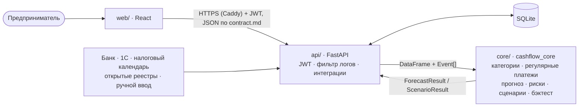

# Архитектура решения

Сервис прогнозирует остаток на расчётном счёте малого бизнеса по дням на 30+ дней вперёд, находит кассовые разрывы (дата, сумма, вероятность) и объясняет их простыми словами.

Схема: [`architecture.svg`](architecture.svg) · [`architecture.png`](architecture.png) · исходник [`architecture.mmd`](architecture.mmd).



> Описание опирается на контракт [`contract.md`](contract.md); подробности — в [`api/README.md`](../api/README.md) и [`core/README.md`](../core/README.md).



## 1. Компоненты

| слой | папка | ответственность | технологии |
|---|---|---|---|
| Интерфейс | `web/` | понятный экран «хватит ли денег», графики, сценарии, ручной ввод | React, Vite, TypeScript, Recharts |
| API | `api/` | аутентификация и демо-вход, REST по контракту, хранение, интеграции-имитации, план-факт, прогноз без входа `/predict`, лимит запросов, фильтр логов | FastAPI, JWT, SQLAlchemy + SQLite |
| Ядро | `core/` | загрузка и чистка выписки, категоризация, регулярные платежи, налоги, прогноз, риски, сценарии, проверка качества (`evaluate`, `control`) | Python, pandas, scikit-learn |
| Публикация | `deploy/`, `docker-compose.yml` | раздача интерфейса и HTTPS, прокси `/api` | Docker, Caddy (Let’s Encrypt) |
| Данные | `data/raw/` | выписки 150 компаний за 01.10.2024–30.09.2026 от организаторов | CSV |
| Демо-данные | `data/synthetic/` | сценарий с заложенным разрывом, если в реальных данных нет подходящей компании | CSV |

## 2. Потоки данных

1. **Загрузка выписки.** Пользователь перетаскивает CSV → `web` проверяет файл в браузере (формат, кодировка, колонки) → `POST /api/companies` → `api` сохраняет файл и вызывает `core.load_statement`.
   `load_statement` переводит колонки датасета во внутренние имена (`operation_date → date`, `payment_purpose → purpose`, `Поступление/Списание → in/out`), читает ИНН строкой, убирает дубли, помечает пропуски дней.
2. **Понимание истории.** `categorize` присваивает каждой операции категорию и уверенность (налоги/ЕНП в разных написаниях, зарплата, аренда, кредиты, закупки, выручка, переводы собственных средств, возвраты). `detect_recurring` находит регулярные платежи с периодом и датой следующего.
3. **Будущие события.** Ожидаемые платежи (`Event`) приходят из интеграций и ручного ввода и хранятся в `api`:

   | источник | что даёт | `Event.source` / `type` |
   |---|---|---|
   | Банк (выписка) | история операций, остаток, регулярные платежи, кредиты | `bank` / `loan`, `contract` |
   | 1С | выставленные и полученные счета, договоры, зарплатные ведомости | `1c` / `invoice`, `contract`, `payroll` |
   | Налоговый календарь | даты ЕНП (28-е число) и оценка суммы по истории | `tax_calendar` / `tax` |
   | Открытые реестры | госконтракты и этапы оплаты, данные о контрагентах | `open_registry` / `contract` |
   | Ручной ввод | «клиент обещал заплатить», «закупка оборудования» | `manual` / `manual` |

4. **Прогноз.** `forecast(df, events, horizon)` строит остаток по дням: ожидаемый (`balance_p50`) и возможный диапазон (`balance_low`–`balance_high`). Остаток собирается из потоков:
   - платежи по расписанию: регулярные из выписки и налоги по налоговому календарю;
   - события из источников;
   - остаточные потоки: модель ETS или бустинг, её выбирают по ошибкам прошлых прогнозов на той же выписке.

   Monte Carlo даёт 2000 вариантов будущего: задержки оплат, колебания сумм, прошлые ошибки модели. Остаточные потоки сжимаются к текущему остатку: «остаток не изменится» — сильный бейзлайн, веса подобраны на dev. Дивиденды, займы учредителя и их возврат прогноз не ожидает. Из дней, где остаток может уйти ниже нуля или ниже подушки безопасности, формируются риски: дата, нехватка, вероятность, уровень, причина и рекомендации простым языком. Если счёт закрыт, вместо риска выдаётся предупреждение.
5. **«Что если».** `POST /scenarios/run` → `run_scenarios` пересчитывает прогноз при задержке клиента, потере клиента, падении выручки, внеплановом расходе, росте постоянных затрат или налогов → `web` рисует базовый и сценарный прогноз на одном графике. События и сценарии не сжимаются: их эффект виден полностью.
6. **Новые операции.** `POST /transactions` → `update_forecast(state, new_rows)` обновляет прогноз без полного пересчёта; план-факт показывает, какие ожидаемые платежи не пришли.
7. **Проверка качества.** `cashflow_core.evaluate` прогоняет четыре подхода «из прошлого» (rolling origin, dev и holdout): «остаток не изменится», наивный, сезонный и гибрид. `cashflow_core.control` повторяет проверку жюри: последние 30 дней каждой выписки считаются фактом. `report publish` пишет `core/reports/metrics.json` → страница «Качество прогноза».
8. **Эффект источника.** После синхронизации источника, загрузки выгрузки 1С, договоров или счетов и после ручного платежа экран «Платежи и источники» показывает: было — разрыв и вероятность, стало — новые значения.

## 3. Безопасность

- **Аутентификация:** `POST /api/auth/login` → JWT. `POST /api/auth/demo` даёт гостя с личной копией демо-компании. Остальные эндпоинты требуют `Authorization: Bearer`, кроме `/health` и `/predict`. Токен истекает, при 401 интерфейс возвращает на экран входа. Пароли хранятся как PBKDF2-хэши.
- **Изоляция данных:**
  - загруженные компании и личные копии видит только владелец, остальным отвечаем 403;
  - компании датасета и демо общие, их можно только читать, любое изменение получает 403;
  - выбор общей компании как своей создаёт копию.

  Тест `api/tests/test_demo_security.py` проверяет, что события одного гостя не видны другому.
- **Ограничения:** не больше 300 запросов в минуту с IP и 20 «тяжёлых» (вход, загрузка файла, прогноз без входа), файл до 20 МБ.
- **Логи без чувствительных данных:** фильтр на всех логгерах маскирует ИНН, наименования контрагентов, назначения платежей, суммы, e-mail и токены. Журнал запросов пишет только метод, путь, код ответа и время. Тест прогоняет полный сценарий и проверяет логи.
- **Интерфейс:** выписка не сохраняется в браузере; в `localStorage` — только токен и id компании.
- **Данные:** все компании и ИНН в датасете вымышленные.

## 4. Развёртывание

```
браузер ──HTTPS──► web (Caddy: статические файлы, сертификат Let’s Encrypt) ──/api──► api (uvicorn) ──import──► core
                                                                                      └── SQLite в томе api_data
```

- **Публично:** `docker compose up -d --build` на VPS, домен или `<IP>.sslip.io` — в `.env`. Шаги для Ubuntu (Aeza) описаны в [`deploy.md`](deploy.md), проверка — `scripts/smoke_test.sh https://<домен>`. Секреты (`JWT_SECRET`, пароли `API_USERS`) хранятся только в `.env` на сервере.
- **Локально:** `uvicorn api.main:app --port 8000` и `cd web && npm run dev` (Vite проксирует `/api`); подробности — в корневом [`README.md`](../README.md).

## 5. Развитие

- Реальные коннекторы: API банка Центр-Инвест (выписка в реальном времени), обмен с 1С, ФНС.
- Push/Telegram-уведомления о приближающемся разрыве.
- Подбор продукта банка под разрыв (овердрафт, кредитная линия) прямо из предупреждения.
- Обучение на всех клиентах банка: отраслевые профили сезонности и платёжной дисциплины контрагентов.
